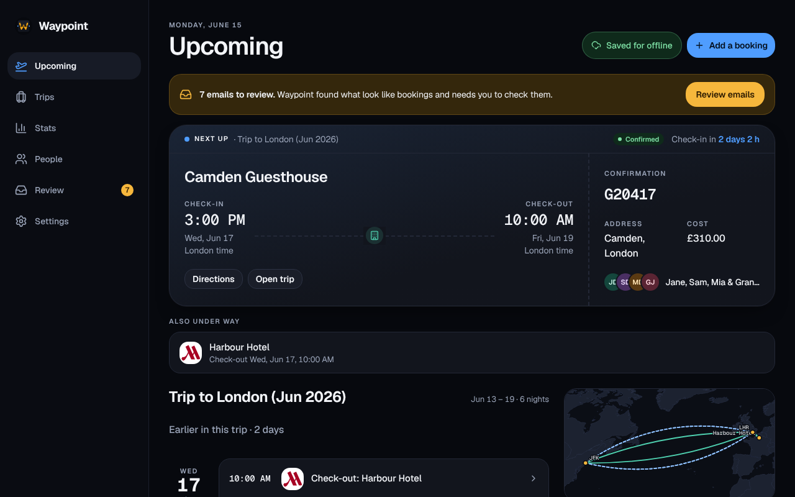
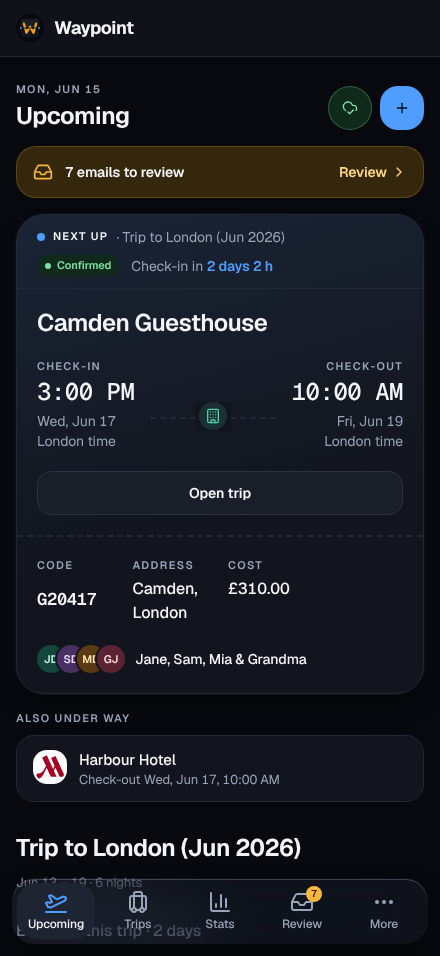
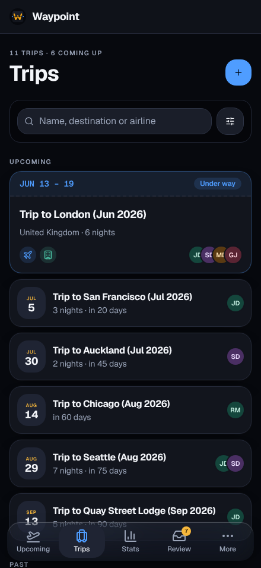

# Waypoint

[](https://github.com/AnthonyPluth/Waypoint/releases/latest)
[](https://github.com/AnthonyPluth/Waypoint/pkgs/container/waypoint)
[](LICENSE)
[](https://app.codecov.io/gh/AnthonyPluth/Waypoint?flags%5B0%5D=backend)
[](https://app.codecov.io/gh/AnthonyPluth/Waypoint?flags%5B0%5D=frontend)

A self-hosted travel app for a household. Waypoint shows each person the trips they’re on, keeps the family’s loyalty and Known Traveler numbers in one place so anyone can book for anyone, and reads booking emails on your own server.

<p>
  
  
</p>

**[Try the read-only demo](https://anthonypluth.github.io/Waypoint/demo/)** · **[Documentation](https://anthonypluth.github.io/Waypoint/)** · **[Install with Docker](https://anthonypluth.github.io/Waypoint/start/docker/)**

## What it does

- **Trips.** Flights, stays, rental cars, trains, cruises and parking, with confirmation numbers, travellers, costs and a link to manage each booking. Times are shown where they happen, in the airport’s or hotel’s own zone. Past flights import from a Flighty, myFlightRadar24, OpenFlights or App in the Air export.
- **Gmail scanning.** Each member connects their Gmail read-only. Waypoint finds booking emails, reads them in memory on your server and adds the bookings. Anything it couldn’t read waits in **Review**, where you add the booking by hand, match a name to a person, ignore a sender or dismiss it.
- **People and loyalty IDs.** Household members and guests, with frequent-flyer, hotel, car, cruise, TSA PreCheck and Global Entry numbers, encrypted at rest and masked until asked for.
- **Before and during a trip.** Upcoming leads with what’s next. Live flight status, check-in and day-of reminders and a private calendar feed are optional, and your upcoming trips open offline, encrypted on the device.
- **Stats.** Flights, distance, airlines, hotel nights, rental days, cruises and the places you’ve been, on a map.
- **Optional AI.** Off by default. A local Ollama, or OpenRouter with zero data retention, can read the booking in an email Waypoint couldn’t; what it can’t complete waits in Review for you to check. Claude and other assistants can connect over MCP to read your trips and, if you allow it, change them.
- **Your own infrastructure.** SQLite or Postgres, downloadable and restorable backups, and optional OpenID Connect sign-in with the provider you already run (Authentik, Keycloak, Pocket ID, Google, …).

<p>
  
  
</p>

## Quick start

```bash
git clone https://github.com/AnthonyPluth/Waypoint.git
cd Waypoint
docker compose up -d
```

Open `http://localhost:8765`. No account, `.env` file or API key is needed to start: add people and bookings by hand, and connect Gmail, AI or live flight status later if you want them. Brand logos and the map are bundled. The database and its encryption key live in `./data`; keep that folder.

The image is `ghcr.io/anthonypluth/waypoint` (Intel/AMD and ARM), tagged `latest` and by version (`2`, `2.131`, `2.131.5`). Every push to `main` that passes the tests becomes a release; update with `docker compose pull && docker compose up -d`.

One deployment serves one household. Before you put it on the internet, read [Install with Docker](https://anthonypluth.github.io/Waypoint/start/docker/): HTTPS in front, sign-in limited to your household, a secret key you keep, and private backups.

## Privacy

Waypoint sends nothing about itself anywhere: no analytics, no error reporting, no logo or map service. Your email is read on your server and never stored in the clear. You see only the trips you’re on or booked. Loyalty and Known Traveler numbers are encrypted and never appear in logs, notifications or hosted AI prompts. The exact promises, and the checks that hold the code to them, are in [Waypoint’s promises](AGENTS.md#waypoints-promises); [Email scanning](https://anthonypluth.github.io/Waypoint/privacy/email-scanning/) explains what a scan reads and keeps.

## Documentation

- [Install with Docker](https://anthonypluth.github.io/Waypoint/start/docker/) and [Configuration](https://anthonypluth.github.io/Waypoint/reference/configuration/)
- [Trips](https://anthonypluth.github.io/Waypoint/start/trips/), [People](https://anthonypluth.github.io/Waypoint/start/people/), [Loyalty numbers](https://anthonypluth.github.io/Waypoint/start/loyalty/) and [Stats](https://anthonypluth.github.io/Waypoint/start/stats/)
- [Gmail](https://anthonypluth.github.io/Waypoint/start/gmail/), [Review](https://anthonypluth.github.io/Waypoint/start/review/) and [AI suggestions](https://anthonypluth.github.io/Waypoint/start/ai/)
- [Live flight status](https://anthonypluth.github.io/Waypoint/start/flight-status/), [Reminders and calendar](https://anthonypluth.github.io/Waypoint/start/reminders/), [Offline](https://anthonypluth.github.io/Waypoint/start/offline/) and [AI assistants (MCP)](https://anthonypluth.github.io/Waypoint/start/mcp/)

## Contributing

Python 3.14 backend, Svelte web app, Starlight docs. [Development](https://anthonypluth.github.io/Waypoint/contributing/development/) covers setting up a checkout and running the checks; `make check` runs everything CI runs locally. AI coding agents start from [AGENTS.md](AGENTS.md). To report a vulnerability, see [SECURITY.md](SECURITY.md).

## License

[AGPL-3.0](LICENSE)
