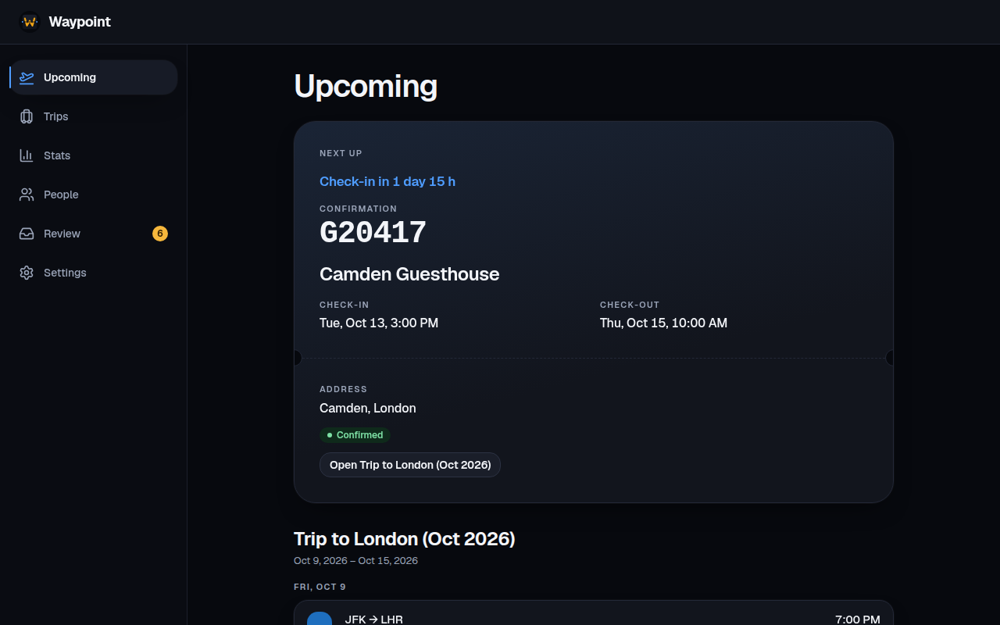
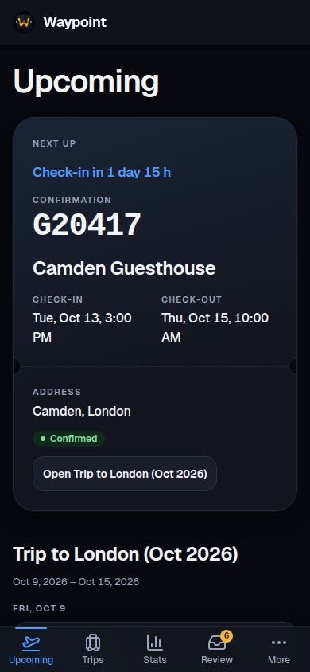
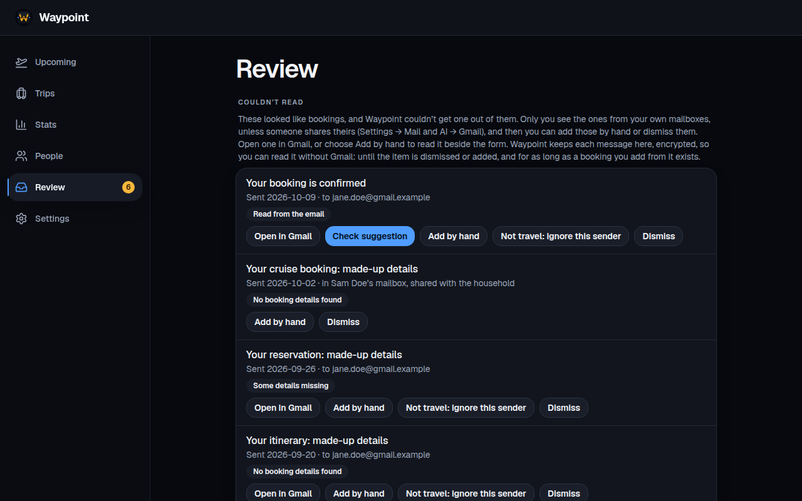

# Waypoint

[](https://app.codecov.io/gh/AnthonyPluth/Waypoint?flags%5B0%5D=backend)
[](https://app.codecov.io/gh/AnthonyPluth/Waypoint?flags%5B0%5D=frontend)

A self-hosted travel app for a household. Waypoint shows everyone the trips they’re on, keeps the family’s loyalty and Known Traveler numbers in one place so anyone can book for anyone, and reads booking emails privately on your own server.

<p>
  
  
</p>
<p>
  
</p>

## Features

- **Trips.** Flights, stays, rental cars, trains, cruises and parking reservations, with confirmation numbers, travellers, what each cost (read from the email or entered by hand, totalled per currency and never converted) and links to manage each booking. Times are shown where they happen, in the airport’s or hotel’s own zone. Past flights can be imported from a CSV (Flighty, myFlightRadar24, OpenFlights, App in the Air).
- **Gmail scanning.** Each member can connect a Gmail read-only. Waypoint finds booking emails, reads them in memory and adds the bookings. What it couldn’t read goes to a **Review** queue, where you add the booking by hand, match names to people, ignore a sender or dismiss it.
- **Optional AI fallback.** Off by default. For mail Waypoint couldn’t read, a local Ollama or OpenRouter with zero data retention can suggest the booking; you always confirm it.
- **People and loyalty IDs.** Household members and guests, with frequent-flyer, hotel, car, cruise, TSA PreCheck and Global Entry numbers, encrypted and masked until asked for.
- **Before and during a trip.** Upcoming shows what’s next, with live flight status (optional), push reminders and a private calendar feed. The current trip opens offline, kept encrypted on the device.
- **Stats.** Flights, distance, airlines, hotel nights, rental days, cruises, parking days and places, with a map.
- **AI assistants (MCP).** Connect Claude or another assistant to read your trips and, if you allow it, change them. It sees what the member who approved it sees, never email text or loyalty numbers.
- **Backups and sign-in.** OpenID Connect sign-in with your own provider (Authentik, Keycloak, Google, …); downloadable, restorable backups; SQLite or Postgres.

## Quick start

```bash
git clone https://github.com/AnthonyPluth/waypoint.git
cd waypoint
cp .env.example .env      # set WAYPOINT_PUBLIC_URL, OIDC_ISSUER, OIDC_CLIENT_ID/SECRET, OIDC_ALLOWED_EMAILS
docker compose up -d
```

The image is `ghcr.io/anthonypluth/waypoint` (Intel/AMD and ARM). One deployment serves one household. [Install with Docker](https://anthonypluth.github.io/Waypoint/start/docker/) walks through registering Waypoint with your sign-in provider, first start, moving data over and putting it on the internet safely.

## Privacy

Waypoint sends nothing about itself to any outside service. Your email stays on your server, you see only the trips you’re on, and loyalty and Known Traveler numbers are encrypted and never in logs or AI prompts. These are held by checks in the code, and [Waypoint’s promises](AGENTS.md#waypoints-promises) in AGENTS.md are the exact wording. [Email scanning](https://anthonypluth.github.io/Waypoint/privacy/email-scanning/) says what a scan reads and keeps, and [SECURITY.md](SECURITY.md) covers what Waypoint holds and how to run it safely.

## Documentation

The docs are at https://anthonypluth.github.io/Waypoint/:

- [Install with Docker](https://anthonypluth.github.io/Waypoint/start/docker/) and [configuration](https://anthonypluth.github.io/Waypoint/reference/configuration/), every environment variable
- [Trips](https://anthonypluth.github.io/Waypoint/start/trips/), [Gmail setup](https://anthonypluth.github.io/Waypoint/start/gmail/), [Review](https://anthonypluth.github.io/Waypoint/start/review/), [AI suggestions](https://anthonypluth.github.io/Waypoint/start/ai/), [AI assistants (MCP)](https://anthonypluth.github.io/Waypoint/start/mcp/) and [offline](https://anthonypluth.github.io/Waypoint/start/offline/)
- [Contributing](https://anthonypluth.github.io/Waypoint/contributing/development/): setting up a checkout and running the checks. AI coding agents start with [AGENTS.md](AGENTS.md) and [CLAUDE.md](CLAUDE.md); [docs/feature-map.json](docs/feature-map.json) says where each feature lives.

To report a vulnerability, see [SECURITY.md](SECURITY.md).

## License

[AGPL-3.0](LICENSE)
