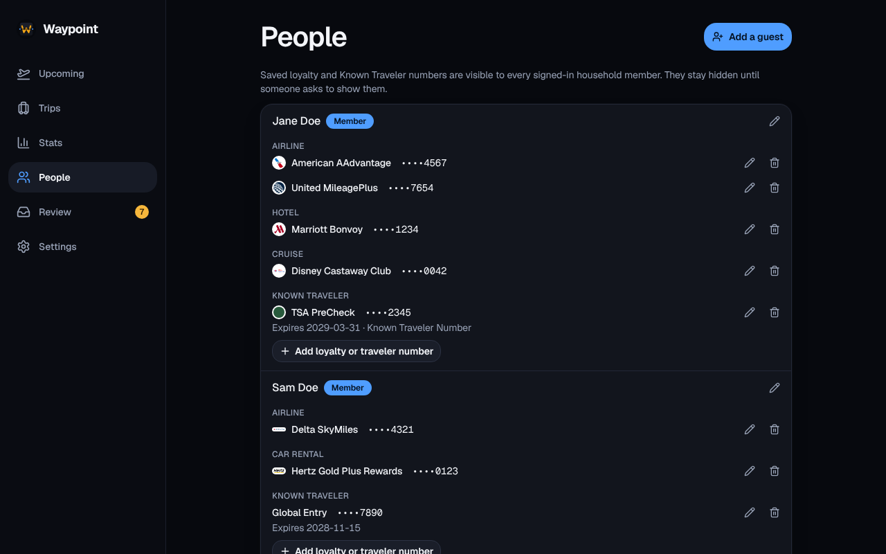

The **People** page lists everyone who travels with your household. Every signed-in member sees all of it, so anyone can add or fix a name.

## Members and guests

- **Members** are the people who sign in. Waypoint adds someone the first time they sign in, using the name their provider gives; later sign-ins don’t change it, so a corrected name stays corrected. You can edit a member’s names but not remove them.
- **Guests** have no login: children, grandparents, a friend who comes along. Any member can add, rename or remove a guest.

## Names

Each person has a **display name**, a **first name** and a **legal name**, the name on their ID and bookings. Under **Advanced matching** you can add **name aliases**, one per line: the ways an airline prints their name, such as `DOE/JANE MS`.

Waypoint matches a booking’s passengers against these names. When a name matches both a member and a guest, the booking goes to the member. When it matches two members, or two guests, Waypoint doesn’t guess and asks in Review.

## If you were already a guest

A booking whose passenger matches nobody is added as a guest. When that person later signs in they become a member of their own, and without a link between the two they would see none of those trips.

- If you have no trips and a guest’s name, legal name or an alias matches yours, Upcoming asks “Are you one of these?”. **This is me** links you to that guest; **None of these** hides the question.
- A guest on the People page has a **This is me** button too. You can only link a guest to yourself, never to someone else.

Linking moves everything on the guest to you: their trips and bookings, loyalty and Known Traveler numbers, and legal name and aliases, added to yours without repeats. You keep your own name and first name, and the guest is removed. If you both had a different number for the same program, both are kept and People says “Two numbers for …” so you can remove the wrong one.

Linking can’t be undone in Waypoint; restoring a [backup](/Waypoint/start/docker/#moving-your-data-from-another-machine) is the way back. Merging two members, or two guests, isn’t supported.

## Editing

**Add a guest** and the pencil beside a person open the name form; **Add loyalty or traveler number** opens the [membership](/Waypoint/start/loyalty/) form. What you type is held in the page only, never in the browser’s storage, so a loyalty number you discard is gone.

## In a backup

People are part of a [backup](/Waypoint/start/docker/#moving-your-data-from-another-machine) and come back as they were, each member still linked to their sign-in.
