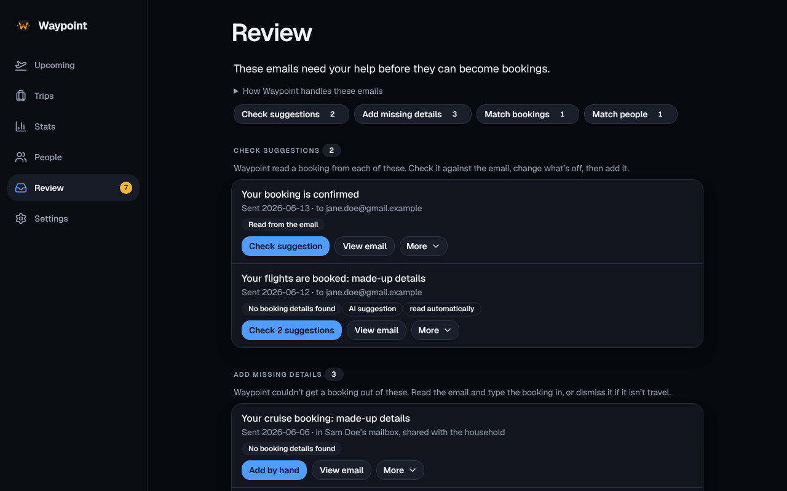

**Review** is where Waypoint asks for help: emails it couldn’t turn into bookings, emails that fit more than one booking, and names it couldn’t match to a person. A number on the Review tab says how much is waiting.

What is waiting is grouped by the decision it needs, each group titled with its count. Empty groups aren’t shown.

- **Check suggestions**: emails Waypoint (or the optional [AI](/Waypoint/start/ai/)) already read a booking from, or read only in part. Check the suggestion and add it.
- **Add missing details**: emails nothing could read. Add the booking by hand.
- **Match bookings**: an email that fits more than one booking you added yourself ([below](#match-bookings)).
- **Match people**: a name on a booking that Waypoint couldn’t match to a person ([below](#match-people)).

## Check suggestions and Add missing details

A message lands here when it looks like a booking (from an airline, hotel, rental company, railway or booking site, with a confirmation word in it) but Waypoint can’t get a booking out of it. Each item shows who it came from, the day it was sent, the message’s subject and why:

- **No booking details found**: the email carries no machine-readable booking, and Waypoint has no parser for that sender.
- **Some details missing**: it has booking markup, but not enough for a segment (no arrival time, an unknown airport, a hotel whose time zone can’t be worked out, or times marked UTC that could be the local clock).
- **Couldn’t be opened**: the message itself was damaged.

Most senders put no machine-readable booking in their emails; those are the ones to add by hand or ignore. Messages Gmail files under Purchases or Reservations can also land here, such as a restaurant or an appointment: dismiss them. How a scan chooses what to read is under [Scanning](/Waypoint/start/gmail/#scanning).

Each email has a main button (**Check suggestion** or **Add by hand**), **View email**, and a **More** menu. **More** has two parts so that dismissing one email can’t be mistaken for ignoring a sender: **This email** (**Add by hand instead**, **Ask AI** or **Ask again**, **Dismiss**) and **All future mail from** the sender’s domain (**Not travel: ignore this sender**).

### Add by hand

**Add by hand** opens a form for the booking with the sender’s name filled in as the provider and the message beside it, so you can read the details and type them in one place. A booking added from Review can be a flight, hotel stay, car rental, train, cruise or parking. A hotel has one time zone: type it, or leave it empty and give the address, and Waypoint works it out. A cruise has no ports of call until you add them on the booking.

Saving adds the booking to your trips, takes the item off the list and keeps the message with the booking.

- **Several bookings in one email.** **Add another leg or booking** adds a second form with the same kind, provider and confirmation code (and, for a flight, the previous flight’s destination as its origin). **Add 3 flights** checks every leg first, then adds them in order and clears the item after the last. If one can’t be added, the ones already added stay added and the item stays until the rest are added or you close the form.
- **A booking you already have.** If what you typed is the same reservation as one you can see (the matching rules are under [Merging into your trips](/Waypoint/start/gmail/#merging-into-your-trips)), Waypoint stops with “This looks like a booking you already have”. **Add the email to that booking** keeps the message with it and makes no second booking: only what it lacked is filled in. **Add as a separate booking** adds it as typed. A booking you can’t see is never offered.
- **Several emails about one reservation show as one row.** When waiting items are in the same mailbox, from the same sender domain, and each name the same confirmation code (and no other), Waypoint shows them as “3 emails about the same reservation”, newest first. **Dismiss all** removes them together. **Add by hand** or **Check suggestion** works on the newest; once the booking is added, that email stays with it and the others are removed. The number on the Review tab counts rows, not emails.

### View email

**View email** shows the message here without adding it, as it was formatted (headings, lists, tables, bold and links), or as plain text if it had no formatting. It is the copy Waypoint kept, so it opens without Gmail, for anyone who can see the item. A booking made from an email has a **View email** button on its card in the trip too.

- It fits the screen width by default. Zoom buttons go up to 300% and **Fit** goes back, and **Larger view** opens it full screen.
- Nothing the sender wrote can run, and its styles can’t change Waypoint’s. Pictures are the copies Waypoint kept, so opening the message tells the sender nothing ([what the sender can learn](/Waypoint/privacy/email-scanning/#what-the-sender-can-learn)).
- Links open in a new tab, and only `https` and `mailto` ones are kept. A link goes to the sender’s own address, which may identify you, so choosing one is visiting their site.

### Ask AI

When the optional [AI suggestions](/Waypoint/start/ai/) are set to Local (Ollama), **Ask AI** asks the model about this one message now. Complete results are added to trips automatically; partial ones stay here to complete. A suggestion a scan asked for by itself arrives filled in, with a **read automatically** label ([Reading unreadable mail automatically](/Waypoint/start/ai/#reading-unreadable-mail-automatically)).

When the model finds no booking and judges the email plainly not one (a promotion, a loyalty or account statement or a newsletter), the item is dismissed for you and a message says why. The same happens during a scan when the AI reads automatically ([Emails that aren’t bookings](/Waypoint/start/ai/#emails-that-arent-bookings)).

When two or more items have no suggestion yet, **Ask AI about all** asks about each in turn, stops at the first failure and says how many it got through. A line beside it says the text goes to your own Ollama server, unredacted. When the list is narrowed to one sender or mailbox, it becomes **Ask AI about these N emails** and asks only about those. Any member who can see an item can ask ([who can ask](/Waypoint/start/ai/#who-can-ask)).

### Not travel and Dismiss

- **Not travel: ignore this sender** is for shopping and other mail that was never travel. After asking, with the number of items that will go, later scans skip that sender’s mail for this mailbox, and its other items leave the list with their kept messages. Items that hold bookings to settle stay, and a booking already made from one of their emails is never touched. The confirmation warns when the sender is an airline, hotel group or other travel company Waypoint knows, since its bookings then won’t be added. A message at the bottom of the screen has an **Undo** for a few seconds; afterwards undo it under [Ignored senders](/Waypoint/start/gmail/#ignored-senders).
- **Dismiss** takes an item off the list because it isn’t a booking. Waypoint first asks, saying how many emails go, because it deletes its stored copy of each for good: there is no undo and no hidden archive. Your mailbox isn’t touched, Waypoint remembers it has read the message so it doesn’t come back, later mail from the same sender is read as usual, and bookings already added from it stay.

Follow-up mail for a booking you already have (a receipt, a check-in notice) never reaches Review: it is attached to the booking quietly ([how](/Waypoint/privacy/email-scanning/#what-is-kept)).

### Who sees these items, and for how long

Items are private to the member whose mailbox they came from: nobody else sees them, or even that they exist, until that member shares the mailbox. Waypoint keeps the message, encrypted, for as long as something needs it. What is kept and when it is deleted is on [Email scanning](/Waypoint/privacy/email-scanning/#what-is-kept).

### Sharing a mailbox’s items with the household

In **Settings → Mail & review → Gmail**, each mailbox has a box, **Show this mailbox’s unread mail to the household**, off until its owner ticks it. Only the owner can, and unticking it hides the items again at once. While it’s on, every member sees that mailbox’s items in Review, marked with whose mailbox they’re in, and the Review tab counts them.

Members see what the owner does (subject, sender, day, why it couldn’t be read, and what the AI read from it) and can **View email**, **Add by hand** or **Dismiss** an item, so anyone can clear the queue. **Ask AI** is open to every member who sees the item; **Not travel: ignore this sender** stays with the mailbox’s owner. A mailbox, and what it shares, ends with its owner’s access.

## Match bookings

When a booking email (one with a confirmation code) fits more than one booking you added by hand without a code, Waypoint can’t tell which it is, so it doesn’t add the email and doesn’t guess. An item here shows the email’s booking and each booking it could be, with its trip.

- **It’s this one** fills in that booking with the email’s confirmation code, provider and link (a field you edited by hand is left as it is), and keeps the email with it.
- **It’s a new booking** adds the email as a booking of its own.
- **Dismiss** takes that booking off and adds nothing. If the same email held another booking, that one stays until you settle it too.

The bookings it could be are shown only to people who can see them. Someone else in the household who sees the item through a [shared mailbox](#sharing-a-mailboxs-items-with-the-household) sees it without the bookings that aren’t theirs, and can still add it as a new booking. These items don’t go to the AI.

## Match people

A booking prints each traveller’s name its own way (`DOE/JANE MS`). Waypoint matches a name to a person by the loyalty number on the booking first, then by the person’s display name, legal name or aliases on [People](/Waypoint/start/people/); it never picks between two people with the same name. A name nobody matches stays as printed, and the booking is then visible only to whoever’s mailbox it came from.

Each such name is listed here with the segment it’s on. Choose the person it is, or add a guest. Every traveller with that printed name on your trips becomes that person, and the printed name is kept as one of their aliases, so the next booking with it matches by itself.

A hotel, rental car or parking booking added from an item, like one added by hand, is for everyone on the trip it joins, so its guest name is not kept.

## Letting an AI assistant help

An assistant you connected over [MCP](/Waypoint/start/mcp/#the-review-queue) can list these items, compare each with your trips (with a confidence of exact, likely or possible, and the fields that agreed) and, if you allowed changes, match, add or dismiss them. It sees only what Waypoint read from each email, not the email, unless you switched on **Read email text** for that connection in Settings.
