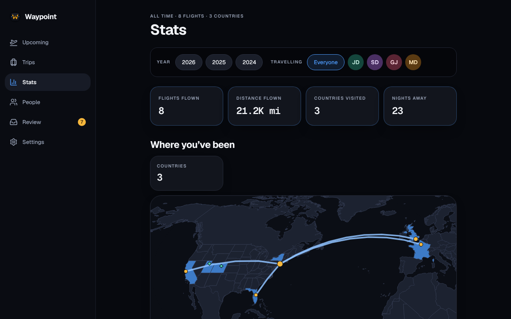

The **Stats** page adds up what you have flown, stayed and driven, and draws it on a [map](#the-map). Pick who and when at the top: one person, a member or a guest, or **Everyone**, and a calendar year or all time. The choice is kept in the address, so you can link it.

Below the headline totals, the page has a section for **Where you’ve been** (the map and the countries), then **Flights**, **Hotels**, **Cars**, **Parking** and **Cruises**, each with its own numbers and top-five lists. A section with nothing finished isn’t shown. Miles or kilometres is a household setting, under **Settings → Travel preferences → Distances**.

## Who and when

- **Person.** One person’s stats count the segments they travel on. Everyone counts each segment once, however many of you were on it.
- **Only trips you can see.** Stats come from the trips you can see (see [Trips](/Waypoint/start/trips/)), so your partner’s view of your stats never includes your solo work trips.
- **Year.** A flight belongs to the year it departs, by the departure airport’s clock; other bookings count the nights or dates that fall in the year.
- **Finished and not cancelled.** A segment counts once its end, by its own place’s clock, has passed. Cancelled segments never count.

## What is counted

- **Flights.** How many, the distance (great-circle between the airports) and the time in the air (booked departure to arrival, each at its own zone, so overnight and date-line flights are right). Also airports visited (a round trip is one visit to each end, a connection one), airlines, countries, top routes (A–B and B–A are one route), cabins, your most flown seat, the longest and shortest flights, the busiest month, and the distance as times around the Earth (40,075 km) and as a fraction of the way to the Moon (384,400 km). An airport Waypoint doesn’t have still counts as a flight but adds no distance or country.
- **Cabins and seats.** Cabins are grouped by the words in the fare: “Basic Economy” and “Main Basic” are Economy; Premium Economy, Business and First are kept apart. Window, aisle and middle come first from the word the airline’s email prints with the seat, then from the aircraft’s layout for economy seats on the Airbus A320 family and A350 and the Boeing 737, 757, 777 and 787 (so 12F is a window on a 737 and a middle seat on a 777). Anything else is “unknown”. Your stats count your own seat on a flight; Everyone’s count every traveller’s.
- **Hotels.** Nights away (each night once, however many stays overlap it), the chains, and the cities and countries stayed in when the booking names a place Waypoint can find. A chain is the hotel’s brand when its name says one (a Westin counts for Marriott), otherwise the booking’s provider, unless that is a booking site such as Expedia. A stay of at least one night counts; the lists rank hotels and cities by nights, and the records add the longest stay and the most-visited hotel and city.
- **Rental cars.** Days with a car out, each day once, and the companies.
- **Parking.** Parking days (every date from entry to exit inclusive, so Monday morning to Thursday evening is four, each date counted once however many bookings overlap it), the number of bookings, and the lots ranked by stays.
- **Cruises.** How many, the nights aboard, the **sea days**, the ports of call and the cruise lines. A sea day is a date strictly between embarking and disembarking with no port arrival. A cruise counts in the year its nights fall in, once finished.
- **Places.** Countries and cities from flights and hotels together, with the date of the first visit and the number of visits. A visit is each time you arrived from somewhere else (or left, for a place you only flew out of), so a round trip is one visit and hops inside a country aren’t visits to it. A city’s flights and hotel stays are counted together: spans that overlap or are a day apart at most are one visit. [Past trips you added by country and dates](/Waypoint/start/trips/#past-trips-you-only-remember) count as a visit to each country but add no city, night or distance.

A flight’s airline comes from the two-character code its flight number starts with, named from [OpenFlights](/Waypoint/reference/data-sources/); a code that isn’t in the list shows as the code.

## The map

The map shows everywhere you have flown and stayed, for the person and year you picked: an arc for each route (thicker for more flights), a dot for each airport (bigger for more visits), a diamond for each city you stayed in, and shaded countries that hold one of those. A key under the map names each mark. Tap or hover a mark for its name and count; tap an arc or a diamond to list the trips on it under the map.

- **States.** The United States is shaded state by state; other countries are shaded whole. A state is filled when something in it is on the map: an airport you flew to or from; a hotel, parking lot, rental car or train Waypoint can locate; a cruise’s embarkation or disembarkation port; a port of call Waypoint can find by name; or a past trip where you chose a state. A port it can’t place, or whose name belongs to several places, is left out and never guessed, so write it with its state, like “Whittier, AK”. Tap a filled state to list the trips that filled it.
- **Where a stay is placed.** At the centre of the ZIP or postal code in its address (see [Where a booking is on the map](/Waypoint/start/trips/#where-a-booking-is-on-the-map)), so two hotels in different ZIP codes of one city are two diamonds; otherwise at its city, or roughly where its city’s airports are. A stay with none of these isn’t plotted, and neither is an airport Waypoint has no coordinates for. No pin is ever at a street address.
- **Zoom.** The map opens on just the places you have been. Drag, pinch or use the buttons to zoom, **Reset** to return to that view and **World** to see everything.

The map is drawn on your device from outlines bundled with the app: countries from [Natural Earth](https://www.naturalearthdata.com/) and US states from the Census Bureau, both public domain. It loads no tiles and calls no map service, so no one outside learns where the household goes; places are found on your own server from lists that ship with Waypoint. Its code and outlines are downloaded only when you open the Stats page.

## Year in review

With a person and a year picked, the Stats page offers **See your year in review**: a run of full-screen cards (distance, flights and time in the air, countries and the new ones that year, the top route and airport, nights away, the map) ending in a card to **Save as image**. It is offered from December 1 for the current year, and any time for past years.

The picture is drawn on your device and saved to your downloads as a PNG. Nothing is uploaded, and there is no button to share it: you choose what to do with the file. It shows totals only: never names, confirmation codes, loyalty or Known Traveler numbers, exact dates, trip names or hotel names, and none of those are passed to the code that draws it.
