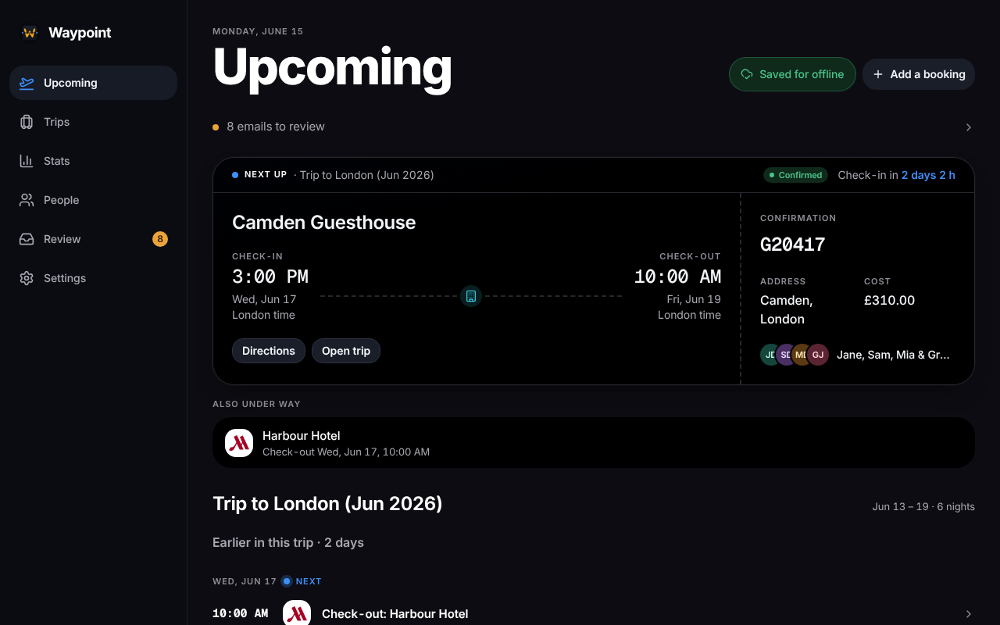
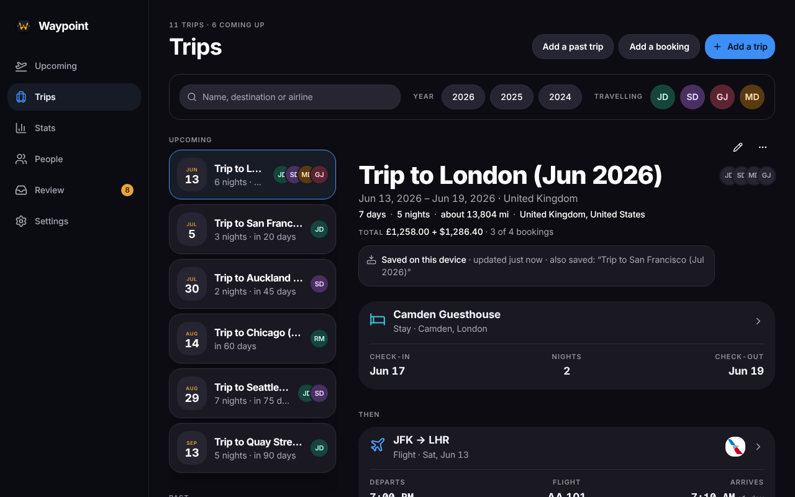

A **trip** is a journey. It holds **bookings** (segments): one flight leg, hotel stay, car rental, train, cruise or parking reservation each. You add them by hand, import past flights, or let Waypoint add them from the booking emails in a connected Gmail (see [Scanning](/Waypoint/start/gmail/#scanning)).

## The pages

**Upcoming** leads with a pass card for what is next: a flight, train or cruise that is under way, otherwise whatever starts soonest. The card shows the airline and flight number, the airports with the time at each in that airport’s own zone (a stay, car or parking booking shows its place and its two times), the confirmation code (tap to copy), the terminal, gate, seats and cabin, and who is travelling. Its top line counts down from the booked times (“Check-in opens in …”, “Departs in …”, “Under way”) or, with [live flight status](/Waypoint/start/flight-status/) on, shows the airline’s latest word: delayed, departed, landed, cancelled or diverted. Under it are the actions: **Check in** or **Open in app**, **Directions**, **Call**, **Show QR code** for a parking booking, and **Open trip**. On a cruise, the ship moves along the dashed line between **Embarks** and **Disembarks** by the booked times: at the left end before it sails, at the right end once it has disembarked. The line behind the ship is solid and in the ship’s colour, and the part ahead stays dashed grey. A cancelled cruise, or one with no times, keeps the ship at the start. A stay, rental car or parking booking you are in the middle of never pushes a departure off the card; it is listed under **Also under way**.

A flight that is next, from a day before it leaves until it lands, shows as a smaller **flight card** instead: the two airports and their times (amber when late, with the zone beside a time only where it differs from the other end or from yours) around a dotted line with a plane at how far along it is, the status, the terminal and gate, and when the status was last updated. The whole card opens the flight’s live status view, and under it stay the confirmation code, **Check in** or **Open in app**, **Directions** and **Call** where the booking has them, **Open trip**, who is travelling and the cost (unless the household has turned costs off). Under it, **Flights today** lists each of today’s flights as a row (route, flight number, time and status) that opens the same view, and a flight opened from the day-by-day list shows a compact booking in a panel: a one-line progress bar with when it left and when it lands. These show what Waypoint holds, with no Refresh button; a quiet line says when live updates are paused.

Below the card, that trip is laid out day by day, each booking at its local time. While you travel, the days already past fold under **Earlier in this trip**. On a wide window a side column shows the trip’s totals (nights, bookings, cities) and **Later**, every other trip still to come; on a phone, **Later** is a row of tiles under the list. When emails are waiting in Review, a banner says how many, and only how many.

With no trips yet, Upcoming says what to do next: **Connect Gmail**, **Add a booking**, and a short setup checklist that disappears with your first trip.

**Trips** lists every trip you can see: the ones to come and under way as ticket cards (dates, name, how soon it starts, destination, nights, what it holds and who is travelling), then past trips grouped by year with each year’s totals. Above the list, **Search** finds trips by name, destination or any booking’s airline, hotel or company; **Year** and **Travelling** narrow it further, and the filters are kept in the address so a copied link shows the same list. On a wide window the list sits beside the selected trip, so you can read a trip without leaving the page. Searching happens on your own server and nothing you type is sent anywhere.

A **trip page** (for a trip that has ended, below its photos; see [Past trips](#past-trips)) is a timeline of cards, one per booking, with the trip’s travellers listed once under its title. A flight on a trip that isn’t over is a **flight card**: the two airports as large codes with a dotted arc and a plane at how far along the flight is, the flight number and total duration above, and each time under its airport with that airport’s zone, never converted (a landing on a later day says so). A delay turns the times amber, with the booked time struck through above the new one. A pill says the state (Scheduled, Boarding, Delayed, In the air, Landed, Cancelled or Diverted); a short line beside it appears only when it adds something the card doesn’t already show (how long until landing, how early or late it landed, whom to contact about a cancelled flight, where a diverted flight was headed, or when live status starts), and the date shows after the Departure or Arrival label when it isn’t today. “Updated N min ago” sits between the times when [live flight status](/Waypoint/start/flight-status/) has an answer for the flight. Four facts sit under it in big type: Terminal, Gate, Seat and Cabin before departure, and the arrival side (Terminal, Gate, Belt and Seat) in the air and once landed. A filled dot marks a fact that came from live status and a hollow ring one from the booking; a fact Waypoint doesn’t hold shows a dash, and a screen reader hears “Not known yet”. Boarding shows when live status has a gate and the flight leaves within 40 minutes, since the status service doesn’t say it. Until live status starts, 1 day before departure, the card gives the departure date, says so and shows the booked times; a status older than 3 hours, or one read while the device is offline, is not used for the times or the sentence; a quiet line says when live updates are paused (monthly limit, rate limit or a refused key); it never invents a gate or a delay. The card opens the flight’s **live status view** (below). The confirmation code, cost, travellers and the booking’s actions stay under the facts. The **live status view** is a page of its own for one flight (`#trip/<trip>/flight/<booking>`), opened from the flight card and open only to people who can see the trip. It repeats the route larger, with the plane on its arc, and a headline that says what is happening: “Departs in 2 hours 10 minutes”, “Boarding now at gate B14”, “Landing in 38 minutes” or “Landed 3 minutes early”, “Cancelled” or “Diverted”, with a progress bar, a timeline (departed, in the air, lands, each with its scheduled and actual time at the airport’s own clock), the arrival facts in big type (Terminal, Gate, Belt; the departure side before the flight leaves) marked by source, each traveller’s seat from the booking and when the status was last updated. **Refresh** (a button on a computer, an icon on a phone) asks for the latest status the way the app already does; if it fails the view keeps what it had and says when that was last updated. Back returns to the trip. A flight’s card lists each traveller with their seat; a hotel, rental car or cruise shows a **Loyalty** line with the masked number of each traveller who has one for that chain or line (tap to reveal and copy). A flight shows no frequent-flyer number, since it was used when the flight was booked; the household’s numbers are on [People](/Waypoint/start/people/). Bookings for bundled brands show the brand’s [logo](/Waypoint/start/logos/). Between the route map and the bookings, a trip page shows the trip’s [photos](/Waypoint/start/photos/#on-a-trip): a strip that opens into a gallery by day and a viewer, with the card that asks whether to [share your own photos](/Waypoint/start/photos/#on-the-trip-page) on the trip and, once you have, **Your photos on this trip**.

## Adding and editing

- **Add a trip** on Trips starts a trip before you have a booking: give it a place or a name (“Lisbon”, “Summer at the lake”) and, if you like, a first and last day. Once it has bookings its dates follow them.
- **Add a booking** on Trips puts the booking in the trip it belongs to or starts one (see [How segments are grouped](#how-segments-are-grouped)); on a trip page it goes in that trip. **Add a past trip** records a trip you only remember (below).
- The booking form asks for what it is, the company and confirmation code, the places and local times, and who is travelling (flights, trains and cruises). A flight needs only its two airports, its times and its travellers; the rest (flight number, seat, cabin, room, manage link, cost) is under **More details**. A new booking starts with only you ticked under **Who’s travelling**, because the people ticked decide who sees the trip.
- A flight’s **From** and **To** take a three-letter code or a search by city or airport name, from the airport list that ships with Waypoint. Time zone fields stay out of the way until a place isn’t on the list.
- On a trip that is still to come or under way, each booking card has **Edit**, and **Move** and **Remove** under **More**; on a past trip they are in the booking’s detail (below). The pencil beside a trip’s name edits its **Name**, **Destination** and **Notes**; **Delete trip**, under **Trip options**, removes the trip and every booking on it after confirming how many.
- Closing a form with unsaved changes asks **Discard changes?** first. A save that fails keeps what you typed and says why.

## The destination under a trip’s dates

The line under a trip’s name shows its dates and its **destination**, such as “Colorado & Texas”. Waypoint writes it from the places of the trip’s bookings in order (a flight where it arrives, a stay by the state or country of its address) and keeps it up to date as bookings change; cancelled bookings and the place you set out from don’t count. Up to four places are listed, and a longer trip counts the rest (“Colorado, Texas, Utah & 2 more”). Type your own destination and Waypoint keeps it exactly as written; clear the field and save to hand it back. All of this comes from lists inside Waypoint, with nothing looked up or sent anywhere.

With the optional [AI fallback](/Waypoint/start/ai/) on, a sparkle button beside the field asks the AI for a short destination. It sends only the trip’s name and the cities, states and countries of its bookings with their kinds: never a date, a confirmation code, a name, an address, a loyalty number or any email text. Nothing is saved until you press **Save**.

## Who sees a trip

You see a trip when you are on it (its people list, which always includes everyone named on any of its bookings), when you booked it or any of its bookings, or when the confirmation for one of its bookings came to your own connected mailbox. Nobody else sees it, however they ask: its address answers “not found”, the same as a trip that doesn’t exist. A solo work trip stays its traveller’s; a trip you book for a child or a grandparent is yours because you booked it. Adding someone to a trip, or as a traveller on a booking, shares the whole trip with them, and their access ends only when they are taken off the trip’s people. Without sign-in, everyone is the one local household and sees every trip.

## Segments

Each segment has a kind (flight, hotel, car, train, cruise or parking), a status (confirmed, changed or cancelled), a confirmation code, the provider, where and when it starts and ends, a link to manage the booking, and details such as flight number, terminal, seat, cabin, aircraft, room, car class, address and phone. A rental car’s **Pick-up place** doubles as its address for Directions, the map and the calendar; an email that gives a separate street address keeps it as **Pick-up address**, and an empty **Drop-off place** means the same as pick-up. The travellers of a flight, train or cruise are people from [People](/Waypoint/start/people/), or a name as printed until it is matched. A hotel, rental car or parking booking never asks who is on it: it is for everyone on its trip.

## Cost

A booking can carry its **cost**, an amount with a currency code. Waypoint never converts between currencies, so a trip’s total is shown per currency (**Total $1,240.00 + €310.00**) and says when some bookings have no cost.

- **From an email.** Waypoint takes an amount only from a line labelled as the total (*Total*, *Grand total*, *Total charged*, *Amount paid* and the like, in English) with a currency beside it. Subtotals, taxes, deposits, nightly rates, points, refunds and amounts with no currency are never taken, and an email with two different totals gives none. A total that covers several bookings under one confirmation code goes on the first of them.
- **By hand.** The edit form’s **Cost** field. A cost you set is yours: a later email never replaces it. A receipt or follow-up fills a missing cost and never changes one that is there; an email that changes the booking updates a cost that came from an email.
- **Cancelled bookings** keep their cost on the card, struck through, and are left out of the total.
- **Settings → Travel preferences → Trip costs** hides costs for the whole household. They stay stored, and turning the setting back on brings them back.

A cost is part of its booking: everyone who can see the booking sees it, and it is part of the [offline copy](/Waypoint/start/offline/) of a saved trip.

## Seats

On a flight or train, each traveller has a seat of their own: tick them in the edit form and a **Seat** field appears under their name. The card shows it beside the name and the calendar event lists the seats by traveller. A seat counts as an edit of the travellers, so a later email won’t change it.

## Actions on a booking

- **Open in app**, or **Manage booking** on a computer: the booking’s manage link from the email (from the email’s own data or, failing that, its “Manage booking”, “View reservation” or similar button, when the email is about one reservation), or one you entered, as an https link to the provider’s site that a phone hands to the provider’s app if it is installed. From 24 hours before a flight departs the button says **Check in** and opens the same link. A flight whose email gave no link opens the airline’s own site or app (United, Delta, Alaska, American, Southwest and others) where you look the booking up by its code; a hotel, rental or other vendor gets **Open in app** or **Open website** the same way. These are plain pages of the vendor’s site: nothing from your booking is in the address, and your device requests them, never the server.
- **Address**: the address of a hotel, parking lot, rental pick-up or cruise terminal, as written. Tap it to open a **Get directions** sheet with Apple Maps (on Apple devices), Google Maps, Uber and Lyft; choosing one opens that app or site with the address filled in. The sheet shows the full address, and a tap also copies it quietly, with no message to cover the buttons. A cancelled booking’s address only copies. **Add address** opens the form at that field. Waypoint never looks addresses up, and the calendar feed carries the address as the event’s location.
- **Directions**: a Google Maps link to the booking’s address or place, or to a flight’s departure airport. Your device hands the text to Google Maps; nothing is sent from the server. The same holds for the sheet above: your device sends the address to the provider you pick, never the server.
- **Call** dials the booking’s phone number.
- **Parking** bookings have a place (the lot), an operator, an address, entry and exit times in the lot’s zone, and details such as the space type and the vehicle (make and colour, never a licence plate). The booking counts as under way while the car is parked. Waypoint reads a parking confirmation that labels its lot, entry and exit and gives the lot’s address; SpotHero confirmations are read too, but they give the lot’s street and not its city, so Waypoint can’t tell the lot’s time zone: unless the address names its state, the email waits in [Review](/Waypoint/start/review/) with what was read filled in, and you add the city and state. One Waypoint can’t read waits there as well, to add by hand. A date written 03/04/2027 is read month first only when the lot’s address is in the United States.
- **Ports of call**: a cruise keeps the ports it calls at, each with its own time zone and local arrival and departure times, and its card shows the sailing day by day, with “Sea day” for a date with no port. A later email fills the list only while it is empty.

## The gate code of a parking booking

A parking reservation’s email often carries the QR code that opens the gate, sometimes only in a reminder sent later. Waypoint keeps that picture with the booking and shows it one tap away. It picks the picture by a fixed rule, without ever reading the code: a near-square PNG or JPEG between 100 and 1,000 pixels a side that the message doesn’t show twice. When exactly one picture qualifies it becomes the code; when several do and an Ollama address is saved ([Ollama](/Waypoint/start/ai/#picking-a-parking-gate-code)), those pictures alone are sent to your own Ollama server, whether a scan filed the booking or you resolved its item in Review, and it chooses one if its model can read pictures, and otherwise, or when it can’t tell, **Choose the code** lets you pick; **Choose another picture** fixes a wrong pick. A code in a later reminder is kept with the booking and nothing else of that email is.

**Show QR code**, on the booking and on the Upcoming card, opens the picture full screen on a white square, sharp, with the lot’s name and times beneath it, and asks the browser to keep the screen on. The button goes once the exit time has passed or the booking is cancelled. In a browser the picture is fetched from your server each time and is never saved, so it needs a connection. The iPhone app keeps it on the phone with your [saved trips](/Waypoint/start/offline/) (owner’s decision, 2026-11-18) and the dialog shows it when the app can’t reach your server; with none saved yet, the dialog says so and shows the confirmation number. The saved-trips page itself has no **Show QR code** button yet; a later change (#850) adds a way to open it from there. Exactly the people who can see the booking can see it, and it is never in the calendar feed, a reminder, a log, the scan’s summary or anything an [AI assistant](/Waypoint/start/mcp/) can read. It is encrypted like the kept emails, in backups too, and goes with the booking, its mailbox and a trip’s **Done**.

## Past trips you only remember

For a trip from long ago, when you know the country and the dates but not the airports or hotels, choose **Add a past trip** on Trips: pick a country (and, for the United States, a state), the first and last day, and who travelled. **Add another country** adds a row for a trip that crossed borders, up to 20, and makes one trip with a **visit** for each. A visit has no times, place or cost and no reminders; it feeds the [Stats](/Waypoint/start/stats/) countries, map and year picker, and nothing else. Waypoint names the trip for its countries and month (“Trip to Ecuador and Peru (Mar 2005)”) unless you name it yourself, and you can add the flights and stays later as you find them.

## Done with a trip

Waypoint keeps a booking’s original email only while something needs it (see [Email scanning](/Waypoint/privacy/email-scanning/)), and nothing deletes it by itself. Once a trip ended at least 7 days ago, its page shows **Done**: confirm **Remove emails** and the saved emails for its bookings are deleted, images included, except one that another booking or a Review item still needs. The bookings stay exactly as they are. Done also marks the trip as done, which hides Edit, Move and Remove on its bookings; it can’t be undone from the app. Anyone who can see the trip can do this, and no AI assistant can.

## Times are where they happen

A booking’s times are the wall-clock times at its places, stored with each place’s IANA time zone (such as `Pacific/Auckland`). Waypoint never converts them to the server’s zone or to UTC: a 22:15 departure from Auckland is 22:15 in Auckland. Type a time as it appears on the booking, without an offset. A flight’s zones come from its airports. A hotel stay has one zone: type it, or leave it empty and Waypoint works it out from the address on your server, from the US state and ZIP code, the Canadian province and postal code, a single-zone country or a city it knows, and asks you when the address doesn’t settle it. The stay’s card shows the zone it uses, so a wrong guess is easy to spot. Every time zone field is a search box: type a city, a region, a state, a common name such as `Eastern` or a country, and pick from the list.

## Where a booking is on the map

When a stay, car, train, cruise or parking booking is saved, Waypoint works out roughly where it is and stores that point with the booking, so the [Stats map](/Waypoint/start/stats/#the-map) can show it. The point is never a street address: it is the centre of the ZIP or postal code in the address, else the airport a car or train names, else the city, when it is clear which city is meant. Everything is read on your server against lists that ship with Waypoint ([Data sources](/Waypoint/reference/data-sources/)); the server contacts no map or geocoding service (the iPhone app can look an address up with Apple’s geocoder on the phone, see [Finding the places of your bookings](/Waypoint/start/ios/#finding-the-places-of-your-bookings)). A booking whose place can’t be read isn’t drawn. The point is in a backup and not shown on the booking’s card.

## How segments are grouped

Without a trip named, a new booking joins an existing trip when it is within two days of it, the trip hasn’t already returned to where it began, and everyone the booking involves is already on the trip. Otherwise it starts a trip of its own, so one person’s solo trip never takes in another person’s booking. A trip you rename, merge or split is yours from then on, and grouping leaves it alone.

On a trip’s page, **Merge another trip** (under **Trip options**) brings another trip’s bookings into this one, and **Move** under a booking’s **More** sends it to another trip or a new one. When the two trips involve different people, Waypoint first says who would newly see what, and goes ahead only when you choose **Move anyway** or **Merge anyway**. An AI assistant can’t confirm such a move or merge; it sends you to the app, while moves between trips of the same people work for it.

## The people on a trip

Besides the travellers on each booking, a trip keeps a list of the people on it. It always includes everyone named on any of its bookings, and it can hold more: the people a road trip is for before anything is booked. Everyone on the list sees the trip and all its bookings, which is why adding someone asks first. A hotel, rental car or parking booking is for everyone on the trip and follows the list; flights and cruises keep the travellers the email names. Taking someone off a trip removes them from its stays and rentals, and is refused while they are on one of its flights. Merging, splitting and moving bookings carry the people along.

## One flight, one card

When the same flight is booked on two reservations (a family split across two confirmation codes), each booking stays its own segment, so change and cancellation emails land on the right one, but the trip page and Upcoming show one card per flight with a block for each code. If the bookings disagree on the times, the card says so and shows each. The calendar feed, the reminders and the flight-status check count the flight once.

## One booking, one segment

A confirmation that arrives twice, in one mailbox or in two members’ mailboxes, makes one segment. Waypoint matches a booking across the household by its kind, confirmation code, places and date, and by its flight number however it is written. Someone who received the confirmation but isn’t on the trip is noted as having received it and sees the whole trip; their email can update or cancel that booking. Nobody else gains access.

## What your edits keep

When you change a field of a booking, Waypoint remembers it was you and a later email never overwrites it. An email about a booking Waypoint already has updates that booking instead of adding another, and marks it *changed* when its times or places moved, or *cancelled* when the provider says so.

## Updated from a newer email

When a newer email for a booking changes its times or places, the booking says **Updated from a newer email** with what changed, beside its *changed* status. If you had edited one of those fields, it keeps your value and the booking says that a newer email disagreed, so you can edit it yourself. See [Merging into your trips](/Waypoint/start/gmail/#merging-into-your-trips) for when an email counts as newer.

## Past trips

On the Trips page, trips that have ended are cards grouped by year, each year with its trip count and, when you are signed in and have [photos](/Waypoint/start/photos/) on those trips, its photo count. A card leads with one large photo and two small ones from the trip, with the trip’s name over the large one and a pill with the number of photos you can see; below it are the dates, the nights, the distance in your unit and the people on the trip. A trip with no photos you can see, and a route of two or more stops Waypoint can place, shows Apple’s map of its area instead, with Waypoint’s own route drawn on top: a flight is an arc, and a drive is the road Apple traced for it when your server has kept one (see [Apple’s map for the route replay](#apples-map-for-the-route-replay)), otherwise a straight line between its stops. Maps need a MapKit key on the server; without one, or when the map can’t load, the card shows a plain tile with the trip’s kinds of booking, the same size, with no message. A card with photos (even when its thumbnails fail to load), or with fewer than two stops, never asks Apple for anything, and no card does while Waypoint can’t tell which trips have photos. Your browser asks your server for a signed address as each card appears and fetches Apple’s image only as the card scrolls near the screen: the address names only the card’s area (its centre and zoom, never closer than city level, and always including Home on a road trip) and size, signed by your server, and never a stop, a name or a date. A trip that spans more than Apple’s widest zoom shows at a card (a flight from New York to London, say) is drawn from a larger image at that widest zoom, shown scaled down to the card; a trip wider still (San Francisco to London, or Los Angeles to Sydney) shows a map of the route’s middle at that zoom, with the ends of the route clipped at the card’s edge, so very wide trips show a clipped map. Across the Pacific the map is centred across the date line. A card whose map failed isn’t retried until you reload the page. Cards run one column on a phone and two across on a wide screen; on a phone only the newest year shows at first, and the next year loads by itself, one at a time, as you scroll near the bottom, with a small “Loading 2025…” line while it does and a polite announcement for a screen reader once it has (focus stays where it is). A browser that can’t watch the scroll shows a quiet **Show more** button at the bottom instead. A past trip always opens on its own page, never in the side pane that shows a trip still to come.

Once a trip has ended, its page leads with its photos. At the top, **Past trips** takes you back to the list, and **Trip options** holds **Add a booking**, **Merge another trip** and **Delete trip**; a pencil beside it edits the trip’s name, destination and notes. Under them:

- **The hero.** A small mosaic of the trip’s three best photos with the trip’s name over it. Waypoint chooses them for you: the photo most worth showing from each place you spent time, the busiest places first (see [Photos](/Waypoint/start/photos/)). Only photos you are allowed to see are used. When you can see fewer than three, or no library is connected, the route map takes the hero’s place, with its Play and Replay controls, and a quiet line says **No photos yet** when there are none at all. With one or two photos the map is the hero and the photos stay in the days below. Without a map (see [Apple’s map for the route replay](#apples-map-for-the-route-replay)) the hero is just the trip’s name and dates, then **No photos yet** when there are none, then the facts line.
- **One line of facts.** Days, nights away, distance and photos (see [A trip’s numbers](#a-trips-numbers)), who travelled, the total when costs are shown (**Settings → Travel preferences → Trip costs**), a **photos need a look** link to Settings, Photos, when a photo of yours or one you manage is far from every booking, and **Replay trip**, which opens the route replay under the line (only where the replay is available).
- **Day by day.** Each day with photos is a dot on a rail with its date, the place most of its photos were taken and how many photos it has, and six photos with a **+N** tile for the rest. A day’s first photo is the first one taken with its own location, or the first of the day when none has one; the others follow in time order. A photo in the hero is not shown again in its day, so a day’s count is the photos left in it. The first three days show, then **Show all** the days. Tapping a photo opens it full size, where you can take it off the trip.

On a desktop the page uses the full width (up to 80 rem; a trip that is still to come or under way keeps its narrower page). The hero is a full-width mosaic of up to seven of the trip’s best photos (three, across the full width, when you can see between three and six), and the page then has two columns. The left column, 400 px wide, stays in view while you scroll the photos: the trip’s days, nights away, distance and places (a count such as “3 states”, or the name when there is one place), the total when costs are shown, the number of photos, who travelled, the **photos need a look** link, a map of the trip’s route with **Replay trip** on it, which plays the replay in the column in place of the map, with its own controls; the map comes back when the replay ends (it is not offered if you have asked your device for reduced motion). With no map available the column has no map block and no **Replay trip**, and the bookings move up. The right column is **Photos by day**: each day’s date, place and photo count with up to twelve photos, six across, and a **+N** tile for the rest, then **Show all** the days. **Open gallery** shows every photo as tiles, by day, and a tile opens the viewer; **Close gallery** goes back to the days. With fewer than three photos the route map is the hero across the full width, and the left column has the facts alone.

The owner decided on 2026-11-18 that a completed trip’s page has none of three things it once drew: the numbered photo pins on the route map (and the **Photos** entry in the map’s key), the numbered list of stops under the replay controls, and the small route squiggle beside each day. Photos are reached through the days, **Open gallery** and the viewer; a trip with photos but no route to replay shows no map.

A past trip lists its bookings in place of booking cards: on a phone a **Bookings** row under the facts opens a sheet that groups them by day (a rental car that spans days under **Whole trip**, parking under **Other**), and on a computer the same list sits in the left column, one row per booking with its date. A cancelled booking keeps its place with a quiet **Cancelled** label, a booking that has changed shows a **Changed** chip on its row, and a confirmation code is never in the list.

Open a booking to see its details: a sheet on a phone and a panel on the right on a computer, named for the booking. It lists the fields that kind of booking has (a flight’s Departs, Arrives, Terminal, Seat and Cabin; a stay’s Dates, Address and Room, with no check-in or check-out time; a rental car’s Pick-up, Drop-off, Car and Pick-up address; a cruise’s Embarks, Disembarks, Ports, Ship, Cabin and Deck; parking’s Dates, Address, Space, Vehicle and Notes; a visit’s Dates, Place and Notes), then the **Confirmation** and **Address**, each with **Copy**, the travellers where the booking card listed them, and the **Price** when costs are shown. A booking that has changed shows a **Changed** chip under its name. A cancelled booking shows a red **Cancelled** label, struck-through dates and price, and a note that it is not in the trip’s total. When two reservations of the same flight are combined and one of them is cancelled, that note sits in a **Status** row with the cancelled reservation’s confirmation code, and each traveller on it is marked “On cancelled booking” with that code. A seat is shown once: beside the traveller’s name, taken from the reservation that still stands, or from the cancelled one when that is the traveller’s only reservation, and the **Seat** row keeps only the seats that no listed traveller has. Directions, Call, the airline’s app and the email are not offered for a trip that is over, and neither are a flight’s gate and live status.

**Edit** is always at the top of the detail, next to **Close**, and opens the same form as before; **More** beside it has **Move** and **Remove**, as under a booking card. Until a trip is marked [Done](#done-with-a-trip), these are there; after it, the detail has only **Close**. A link to `#trip/…?segment=…` opens that booking’s detail. A trip that is still to come or under way keeps its booking cards and its page as it was.

## Replaying a past trip's route

Maps need a MapKit key on the server. Without one Waypoint shows no route replays, and a trip’s page has no map and no **Replay trip**. With one, a trip that has ended, with at least two stops Waypoint can place, shows its route on [Apple’s map](#apples-map-for-the-route-replay) and plays it once: at the top of the page when it has fewer than three photos you can see, otherwise under the facts line when you press **Replay trip** (see [Past trips](#past-trips)). Each flight is an arc with a plane flying along it; after a landing the map zooms into the area and a car travels between the stays there, along a straight line between the stops (with [Apple’s map](#apples-map-for-the-route-replay) on, along the roads Apple’s directions give); a rental car on a trip with a flight is never a stop of its own, it is only the drive between the stops (on a trip without flights a car pick-up is still a stop, unless another booking already visits that place); a cruise is a boat between ports. This is a coarse picture, not the road you drove: a drive Waypoint has no road for is a straight line, and trains and cruises keep a gentle curve between their two places. Without a key no map tiles are fetched and nothing is looked up outside your server; Apple’s map is turned on by giving Waypoint a MapKit key.

**Pause**, **Replay**, a speed button (1×, 2×, 4×) and a slider control the replay. A trip that has ended lists no stops beneath the map: each stop is labelled on the map as the replay reaches it, and the slider names the stop it is on. With reduced motion turned on in your system nothing animates: the map shows the whole path with every stop labelled. Stops come from the airports and from the point stored with each booking ([Where a booking is on the map](#where-a-booking-is-on-the-map)); a booking Waypoint can’t place is left out rather than guessed.

### Apple’s map for the route replay

If you give Waypoint a MapKit JS key from an Apple developer account, the route replay is drawn on Apple’s map (streets and terrain), and there is no replay without one. Each drive (a car between two stops, including one that starts or ends at Home) follows the roads of Apple’s driving directions; a flight, a cruise or a train keeps its arc or curve. Apple’s map shows the stops’ area and nothing else: no photo widens it or reaches Apple (since 2026-11-18 Waypoint draws no photo pins, so a photo’s place never decides what Apple is asked for). A trip with no route to replay never uses Apple’s map, whatever its photos. The stops, the flight arcs, the plane, car or boat, the labels and the controls are drawn over it. The [Stats map](/Waypoint/start/stats/#the-map) is Apple’s too.

This changes who you trust and what leaves your devices, so read it before you add a key. With a key, Apple's script is loaded on every signed-in open of the app, not only when a map is shown: a few seconds after the page loads, when the browser is idle, so the first replay map doesn't wait for it (Waypoint's owner chose this on issue #759: asked whether the map could always be loaded in the background, and told that Apple would then see the viewer's IP and this Waypoint's address on every signed-in open, they chose "Preload when idle after sign-in"). Apple draws a map when a completed trip's replay or, on a desktop, its still map in the left column is shown, which is as soon as the page opens: the browser then asks Apple for the tiles of the trip's area and, for each drive with no road stored on your server, sends Apple's directions service that drive's exact start and end, without waiting for **Replay trip**. On a phone with three or more photos nothing is sent until you press **Replay trip**. Your server, however, asks Apple for the roads of finished trips overnight, which sends Apple those drives’ start and end coordinates whether or not anyone opens a replay (see “Roads prepared ahead” below; Waypoint’s owner decided this on issue #829). It is on by default but does nothing without a key, and there is no per-household or per-trip switch beyond turning it off for everyone:

- **What you are trusting.** Apple’s script is loaded from Apple’s servers on every signed-in open of the app (in the background, a few seconds after the page loads, whether or not you look at a replay), is not pinned (Waypoint can’t pin a version Apple changes) and runs in the page with the same access as Waypoint’s own code: the trips, bookings and loyalty numbers on screen and the signed-in session’s access to your server. So with a key set you are trusting Apple, not only sending it a map area. Apple also sees each viewer’s IP address and browser, and that it was this Waypoint’s address that asked (the script’s request names it, and so does the token Waypoint signs for your `WAYPOINT_PUBLIC_URL`, which carries your Apple Team ID), on every signed-in open, and, once a replay map is drawn, the area they looked at (down to street level around a hotel and around the household’s Home when the replay shows it). To draw each drive along roads, the browser also sends Apple the exact start and end coordinates of that drive, once for each drive (the stay, pick-up or Home a drive begins and ends at; nothing for a flight, cruise or train). Your server signs a short token (30 minutes, for your `WAYPOINT_PUBLIC_URL`) that a signed-in member’s browser asks for, and, once a night, sends Apple the exact start and end coordinates of each drive of a finished trip, in the background, so the roads are ready before anyone opens a replay (see “Roads prepared ahead” below). It does keep the roads Apple returns, as described under “What your server keeps” below.
- **When.** Only when `WAYPOINT_MAPKIT_KEY_FILE`, `WAYPOINT_MAPKIT_KEY_ID`, `WAYPOINT_MAPKIT_TEAM_ID` and `WAYPOINT_PUBLIC_URL` are set and the key loads. The switch `WAYPOINT_MAPKIT_ENABLED` is on by default and does nothing without them; set it to `off` to turn the replay and the Stats map off even with a key. With no key, or off, nothing is preloaded, the server tells the page so without asking Apple, and the route replay is not shown: the page’s content security policy names no Apple host (with a key it is widened for Apple’s hosts and for WebAssembly, which MapKit needs), the Trips cards show a plain tile of the trip’s kinds of booking, and Stats has no map.
- **Stats.** With a key, opening [Stats](/Waypoint/start/stats/#the-map) draws one live map fitted to the chosen period’s airports, stays and places. Apple learns the area on screen and every area you pan or zoom to, down to street level if you zoom that far, from the tiles; Apple’s script is handed only geometry and style (the positions of every airport, flight arc and stay pin of the period and the outlines of the visited countries and US states; never a name, count, date or trip) to draw, and could read them, so it could learn which places, countries and states the household visited in that period. The outlines are bundled with the app and loaded from your Waypoint, never fetched from Apple. The one map that isn’t Apple’s is the picture on the Year in Review cards, drawn on your device from those outlines because it becomes a downloadable image; it contacts no one.
- **If Apple can’t be reached.** If the directions for a drive fail, take more than a few seconds or come back empty, that drive is a straight line, with no message. The preload is skipped offline, in the static demo and when you are signed out, and a preload that fails isn’t retried until a completed trip’s page with two or more stops asks for the map, shown or not, or Stats has something to draw. A missing key, a script that doesn’t load within a few seconds, a refused token, or being offline all leave the replay out, with no message, and a trip’s page has no map and no **Replay trip**. If MapKit raises an error after the replay has shown, the replay is replaced by a quiet line, **The map couldn’t load**, which a screen reader announces politely, and focus moves to the trip’s facts if it was on the replay’s controls.
- **What your server keeps.** The first time a drive is replayed, the browser sends your server the road Apple traced for it, and your server keeps that road (a list of points) for that trip, with the drive’s start and end rounded to about ten metres and when it was kept. Any device of someone who can see the trip then asks your server first and only asks Apple for a drive your server doesn’t have, so a reload or another device draws the road at once. A road belongs to its trip: a lookup of the kept roads of several trips in one request (the Past trips cards use it, only while MapKit is on) answers only for trips you can see (a trip you can’t see reads as one with no roads) and, like the single-trip lookup, only with the roads of drives the trip still makes, so a road whose booking was removed, moved or split off to another trip is not returned for the trip it left; another trip over the same two places keeps its own, a trip you can’t see answers “not found” and is never read from or written to, and a road is removed when its trip is. A row names no person; anyone who can see the trip can already see where it went, and can read and add its roads, but not replace one. A kept road does not expire: it is used for as long as the trip makes that drive, and it is never replaced, even by a better one, so the first one a member of the trip stores is the one drawn from then on. Nothing deletes a road on its own: a road for a drive the trip no longer makes (a booking removed or moved to another trip, or Home deleted) stays, in the database and in backups, until the trip is removed, but no lookup returns it. The roads are part of a [backup](/Waypoint/start/docker/#moving-your-data-from-another-machine) and a restore replaces them with the rest. If your server can’t be reached, is slow (the browser waits a few seconds) or has nothing, the browser asks Apple exactly as before. Apple’s MapKit terms may restrict keeping what its directions service returns; that is not confirmed, and the choice to keep the roads is the owner’s. To stop keeping them, turn MapKit off (`WAYPOINT_MAPKIT_ENABLED=off`): nothing is read or written then, and the rows already kept stay in the database and in backups.
- **Roads prepared ahead.** While MapKit is active your server also asks Apple for the roads itself, so they are ready before anyone opens a replay. A background job wakes once a night at midnight (your server’s local time; `WAYPOINT_ROUTE_WARMING_HOUR` picks another hour) and never runs when Waypoint starts. For each trip that has ended and that the replay would draw (at least two stops from its bookings, so a single stay with Home elsewhere is skipped), works out the drives the replay would draw (the same ones as above: a car between two stops, Home included, never a flight, cruise or train) and asks Apple’s Maps Server API for each one your server has no road for, one at a time a few seconds apart, at most 200 a night. If more are left it carries on the next night; a new trip is picked up then, and a trip that hasn’t changed isn’t worked out again until Waypoint restarts. What Apple learns from this (the owner’s decision on issue #829) is the exact start and end coordinates of each of those drives, from your server’s address and tied to your Apple Team ID, with a token your server signs with the same MapKit key, even if nobody ever opens the replay: so for a trip that has ended, Apple learns where it went. Upcoming trips are never sent. The roads are kept exactly as above, per trip, and read only through the same checks (the trip’s distance also uses them, as a length only). A drive Apple can’t route is skipped until Waypoint restarts. If Apple answers that the key isn’t accepted (401 or 403), the job stops until Waypoint restarts and logs one short line saying so; Apple’s Maps Server API has to be enabled for the key in your Apple developer account (the same key page where MapKit JS is enabled). If Apple can’t be reached the pass ends and the next night tries again; replays then ask Apple from the browser as before. The log says only how many roads were prepared, never a place, a name or a token. Nothing is asked of Apple without an active MapKit key.
- **The Trips list.** For each Past card with no photos you can see and a route of two or more stops, as the card appears (the image itself loads only within about a screen of view), your browser asks your server for a signed address (`GET /api/map-snapshots`: for the trips on screen, at most 12 at a time, only for trips you can see, only while MapKit is on, and only once Waypoint knows which trips have photos) and then loads Apple’s map image from it. The address carries the centre and zoom of the card’s area (the zoom is never closer than city level, and the centre is rounded to about a kilometre; on a road trip the area always includes Home, the same as the replay’s), the image’s size, your language and your Team ID and Key ID, signed with your key, and nothing else: no stop, no path, no name, no date and no trip. Apple can tie the images of one page load together, so it learns, from your IP address, the rough areas of the household’s past trips that have no photos, a few at a time, as you scroll. Your server signs the address and never fetches the image, stores no image, and keeps the signed address in memory for the day so the same card asks Apple for the same image; the address stops working between one and two days after it is signed, and your browser asks again after twelve hours. The image loads with no referrer, so Apple isn’t told which page asked.
- **Not changed.** Assistants can’t reach the token route or the snapshot route, the private key never leaves your server and is never logged, and the offline copy has no route replay (MapKit has no offline tiles).
- **Limits.** Apple allows each developer membership 250,000 map views and 25,000 service calls (a drive’s directions is one) a day, which is far more than a household uses; Waypoint asks once per drive and then remembers the answer on your server, so a reload or a second device doesn’t ask again; its terms and any change to them are Apple’s. Apple’s own attribution shows on the map.

Setting it up: in your Apple developer account create a Maps ID, then a key with MapKit JS and the Maps Server API enabled for it, download the `.p8` file once, copy it to your server and set the values in [Configuration](/Waypoint/reference/configuration/).

### Starting and ending a road trip at home

A road trip (stays, rental cars or visits but no flight, train or cruise) has no booking for getting there and back. Set a **Home** under **Settings → Travel preferences → Home** and the replay starts there and returns there. Home is a city, a state or region, an optional ZIP or postal code and a country, placed on the map from the lists that ship with Waypoint ([Places](/Waypoint/reference/data-sources/#places)); there is no street address and none is kept. The map labels the stop with the city’s name and a house icon, never the word “Home”. Home is one household setting, in backups, read by the browser only with a trip’s map data; it is not used for Stats, distances, the calendar feed or reminders, is never logged or sent to the AI fallback, and an [assistant](/Waypoint/start/mcp/) can’t reach it.

## A trip's numbers

Under a trip’s name and dates, its page shows one line of numbers, worked out on your server from its bookings and its photos (`GET /api/trips/{id}/summary`, answered only to someone who can see the trip; anyone else gets “No such trip”). On a phone the line wraps. It reads like “15 days · 14 nights · 1,284 mi · Colorado, Utah, Arizona, New Mexico · 248 photos (23 placed from the itinerary)”. A number that is zero is left out rather than shown as “0 nights”, and a trip with nothing to count shows no line. Nothing in the line is a button. If the numbers can’t be read, the page shows no line and carries on; it asks again when you add, change or remove a booking, and when you share your photos on the trip or stop.

- **Days**: the trip’s dates, first and last day included. **Nights**: the nights spent in a stay or aboard a cruise, each night counted once when bookings overlap.
- **Distance**, shown in the unit you chose under **Settings → Travel preferences → Distances** (miles or kilometres) and kept by the server in kilometres, split in two. Flights are the great-circle distance between their two airports. Driving is measured over the drives the replay draws (a car between two stops, Home included; a flight, train or cruise in between starts a new drive): along the road Apple gave for a drive when your server has kept one ([Apple’s map](#apples-map-for-the-route-replay)), otherwise as a straight line, and then the road figure is marked as an estimate (so a ride between an airport and a stay, and the leg from or to Home, count as drives too, and read “about” until a road is kept), and the line says “about” before the distance.
- **States and countries**, by name, each once, in alphabetical order. States are the US states of the bookings’ addresses, the states of [past visits](#past-trips-you-only-remember) and the states Immich gives for the trip’s photos taken in the United States. Countries are the flights’ airports, the stays’ cities, past visits and the countries Immich gives for the photos. A photo flagged as far from every booking adds no place until you accept it or move it. Waypoint doesn’t count the state lines a drive crosses. The line lists the states by name; the United States is named only when no state is known, and any other country is listed after the states. Every place is listed, with none hidden behind a “more”.
- **Photos**: how many of the trip’s photos you can see, and how many of those were placed from the itinerary rather than their own location. The line says “248 photos (23 placed from the itinerary)”, and leaves the bracket out when none were. A photo its person hid counts only for that person.
- **Bookings by kind**: how many flights, stays, rental cars, trains, cruises, parking bookings and past visits the trip has.

Cancelled bookings count for nothing. A trip with no booking Waypoint can place gets zero distance and no places. The bookings by kind are worked out but the line doesn’t show them. [Assistants](/Waypoint/start/mcp/) can’t read these numbers.

## In a backup

Trips, bookings, their costs and their travellers are part of a [backup](/Waypoint/start/docker/#moving-your-data-from-another-machine) and come back exactly as they were, times and zones included. The airport list and the lists used to place bookings on the map aren’t: every Waypoint has them already.
