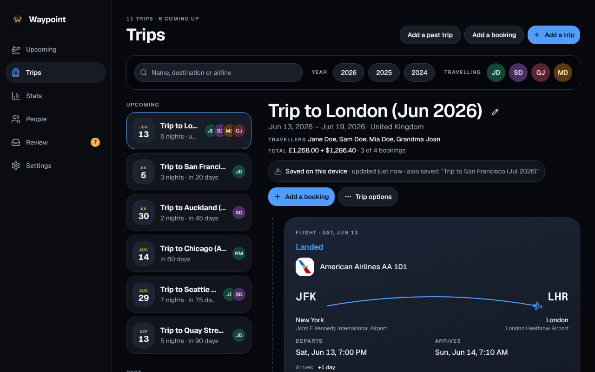

A **trip** is a journey. It holds **bookings** (segments): one flight leg, hotel stay, car rental, train, cruise or parking reservation each. You add them by hand, import past flights, or let Waypoint add them from the booking emails in a connected Gmail (see [Scanning](/Waypoint/start/gmail/#scanning)).

## The pages

**Upcoming** leads with a pass card for what is next: a flight, train or cruise that is under way, otherwise whatever starts soonest. The card shows the airline and flight number, the airports with the time at each in that airport’s own zone (a stay, car or parking booking shows its place and its two times), the confirmation code (tap to copy), the terminal, gate, seats and cabin, and who is travelling. Its top line counts down from the booked times (“Check-in opens in …”, “Departs in …”, “Under way”) or, with [live flight status](/Waypoint/start/flight-status/) on, shows the airline’s latest word: delayed, departed, landed, cancelled or diverted. Under it are the actions: **Check in** or **Open in app**, **Directions**, **Call**, **Show QR code** for a parking booking, and **Open trip**. A stay, rental car or parking booking you are in the middle of never pushes a departure off the card; it is listed under **Also under way**.

Below the card, that trip is laid out day by day, each booking at its local time. While you travel, the days already past fold under **Earlier in this trip**. On a wide window a side column shows the trip’s totals (nights, bookings, cities) and **Later**, every other trip still to come; on a phone, **Later** is a row of tiles under the list. When emails are waiting in Review, a banner says how many, and only how many.

With no trips yet, Upcoming says what to do next: **Connect Gmail**, **Add a booking**, and a short setup checklist that disappears with your first trip.

**Trips** lists every trip you can see: the ones to come and under way as ticket cards (dates, name, how soon it starts, destination, nights, what it holds and who is travelling), then past trips grouped by year with each year’s totals. Above the list, **Search** finds trips by name, destination or any booking’s airline, hotel or company; **Year** and **Travelling** narrow it further, and the filters are kept in the address so a copied link shows the same list. On a wide window the list sits beside the selected trip, so you can read a trip without leaving the page. Searching happens on your own server and nothing you type is sent anywhere.

A **trip page** is a timeline of pass cards, one per booking, with the trip’s travellers listed once under its title. A flight’s card lists each traveller with their seat; a hotel, rental car or cruise shows a **Loyalty** line with the masked number of each traveller who has one for that chain or line (tap to reveal and copy). A flight shows no frequent-flyer number, since it was used when the flight was booked; the household’s numbers are on [People](/Waypoint/start/people/). Bookings for bundled brands show the brand’s [logo](/Waypoint/start/logos/).

## Adding and editing

- **Add a trip** on Trips starts a trip before you have a booking: give it a place or a name (“Lisbon”, “Summer at the lake”) and, if you like, a first and last day. Once it has bookings its dates follow them.
- **Add a booking** on Trips puts the booking in the trip it belongs to or starts one (see [How segments are grouped](#how-segments-are-grouped)); on a trip page it goes in that trip. **Add a past trip** records a trip you only remember (below).
- The booking form asks for what it is, the company and confirmation code, the places and local times, and who is travelling (flights, trains and cruises). A flight needs only its two airports, its times and its travellers; the rest (flight number, seat, cabin, room, manage link, cost) is under **More details**. A new booking starts with only you ticked under **Who’s travelling**, because the people ticked decide who sees the trip.
- A flight’s **From** and **To** take a three-letter code or a search by city or airport name, from the airport list that ships with Waypoint. Time zone fields stay out of the way until a place isn’t on the list.
- Each booking has **Edit**, and **Move** and **Remove** under **More**. The pencil beside a trip’s name edits its **Name**, **Destination** and **Notes**; **Delete trip**, under **Trip options**, removes the trip and every booking on it after confirming how many.
- Closing a form with unsaved changes asks **Discard changes?** first. A save that fails keeps what you typed and says why.

## The destination under a trip’s dates

The line under a trip’s name shows its dates and its **destination**, such as “Colorado & Texas”. Waypoint writes it from the places of the trip’s bookings in order (a flight where it arrives, a stay by the state or country of its address) and keeps it up to date as bookings change; cancelled bookings and the place you set out from don’t count. Up to four places are listed, and a longer trip counts the rest (“Colorado, Texas, Utah & 2 more”). Type your own destination and Waypoint keeps it exactly as written; clear the field and save to hand it back. All of this comes from lists inside Waypoint, with nothing looked up or sent anywhere.

With the optional [AI fallback](/Waypoint/start/ai/) on, a sparkle button beside the field asks the AI for a short destination. It sends only the trip’s name and the cities, states and countries of its bookings with their kinds: never a date, a confirmation code, a name, an address, a loyalty number or any email text. Nothing is saved until you press **Save**.

## Who sees a trip

You see a trip when you are on it (its people list, which always includes everyone named on any of its bookings), when you booked it or any of its bookings, or when the confirmation for one of its bookings came to your own connected mailbox. Nobody else sees it, however they ask: its address answers “not found”, the same as a trip that doesn’t exist. A solo work trip stays its traveller’s; a trip you book for a child or a grandparent is yours because you booked it. Adding someone to a trip, or as a traveller on a booking, shares the whole trip with them, and their access ends only when they are taken off the trip’s people. Without sign-in, everyone is the one local household and sees every trip.

## Segments

Each segment has a kind (flight, hotel, car, train, cruise or parking), a status (confirmed, changed or cancelled), a confirmation code, the provider, where and when it starts and ends, a link to manage the booking, and details such as flight number, terminal, seat, cabin, aircraft, room, car class, address and phone. A rental car’s **Pick-up place** doubles as its address for Directions, the map and the calendar; an email that gives a separate street address keeps it as **Pick-up address**, and an empty **Drop-off place** means the same as pick-up. The travellers of a flight, train or cruise are people from [People](/Waypoint/start/people/), or a name as printed until it is matched. A hotel, rental car or parking booking never asks who is on it: it is for everyone on its trip.

## Cost

A booking can carry its **cost**, an amount with a currency code. Waypoint never converts between currencies, so a trip’s total is shown per currency (**Total $1,240.00 + €310.00**) and says when some bookings have no cost.

- **From an email.** Waypoint takes an amount only from a line labelled as the total (*Total*, *Grand total*, *Total charged*, *Amount paid* and the like, in English) with a currency beside it. Subtotals, taxes, deposits, nightly rates, points, refunds and amounts with no currency are never taken, and an email with two different totals gives none. A total that covers several bookings under one confirmation code goes on the first of them.
- **By hand.** The edit form’s **Cost** field. A cost you set is yours: a later email never replaces it. A receipt or follow-up fills a missing cost and never changes one that is there; an email that changes the booking updates a cost that came from an email.
- **Cancelled bookings** keep their cost on the card, struck through, and are left out of the total.
- **Settings → Travel preferences → Trip costs** hides costs for the whole household. They stay stored, and turning the setting back on brings them back.

A cost is part of its booking: everyone who can see the booking sees it, and it is part of the [offline copy](/Waypoint/start/offline/) of a saved trip.

## Seats

On a flight or train, each traveller has a seat of their own: tick them in the edit form and a **Seat** field appears under their name. The card shows it beside the name and the calendar event lists the seats by traveller. A seat counts as an edit of the travellers, so a later email won’t change it.

## Actions on a booking

- **Open in app**, or **Manage booking** on a computer: the booking’s manage link from the email, or one you entered, as an https link to the provider’s site that a phone hands to the provider’s app if it is installed. From 24 hours before a flight departs the button says **Check in** and opens the same link. A flight whose email gave no link opens the airline’s own site or app (United, Delta, Alaska, American, Southwest and others) where you look the booking up by its code; a hotel, rental or other vendor gets **Open in app** or **Open website** the same way. These are plain pages of the vendor’s site: nothing from your booking is in the address, and your device requests them, never the server.
- **Address**: a hotel’s address as written, which you tap to copy; **Add address** opens the form at that field. Waypoint never looks addresses up, and the calendar feed carries the address as the event’s location.
- **Directions**: a Google Maps link to the booking’s address or place, or to a flight’s departure airport. Your device hands the text to Google Maps; nothing is sent from the server.
- **Call** dials the booking’s phone number.
- **Parking** bookings have a place (the lot), an operator, an address, entry and exit times in the lot’s zone, and details such as the space type and the vehicle (make and colour, never a licence plate). The booking counts as under way while the car is parked. Waypoint doesn’t read parking confirmations by itself yet: add one by hand or from a suggestion in [Review](/Waypoint/start/review/).
- **Ports of call**: a cruise keeps the ports it calls at, each with its own time zone and local arrival and departure times, and its card shows the sailing day by day, with “Sea day” for a date with no port. A later email fills the list only while it is empty.

## The gate code of a parking booking

A parking reservation’s email often carries the QR code that opens the gate, sometimes only in a reminder sent later. Waypoint keeps that picture with the booking and shows it one tap away. It picks the picture by a fixed rule, without ever reading the code: a near-square PNG or JPEG between 100 and 1,000 pixels a side that the message doesn’t show twice. When exactly one picture qualifies it becomes the code; when several do, **Choose the code** lets you pick; **Choose another picture** fixes a wrong pick. A code in a later reminder is kept with the booking and nothing else of that email is.

**Show QR code**, on the booking and on the Upcoming card, opens the picture full screen on a white square, sharp, with the lot’s name and times beneath it, and asks the browser to keep the screen on. The button goes once the exit time has passed or the booking is cancelled. The picture is fetched from your server each time and is never saved in the browser, so it needs a connection; it is not in the [offline copy](/Waypoint/start/offline/). Exactly the people who can see the booking can see it, and it is never in the calendar feed, a reminder, a log, the scan’s summary or anything an [AI assistant](/Waypoint/start/mcp/) can read. It is encrypted like the kept emails, in backups too, and goes with the booking, its mailbox and a trip’s **Done**.

## Past trips you only remember

For a trip from long ago, when you know the country and the dates but not the airports or hotels, choose **Add a past trip** on Trips: pick a country (and, for the United States, a state), the first and last day, and who travelled. **Add another country** adds a row for a trip that crossed borders, up to 20, and makes one trip with a **visit** for each. A visit has no times, place or cost and no reminders; it feeds the [Stats](/Waypoint/start/stats/) countries, map and year picker, and nothing else. Waypoint names the trip for its countries and month (“Trip to Ecuador and Peru (Mar 2005)”) unless you name it yourself, and you can add the flights and stays later as you find them.

## Done with a trip

Waypoint keeps a booking’s original email only while something needs it (see [Email scanning](/Waypoint/privacy/email-scanning/)), and nothing deletes it by itself. Once a trip ended at least 7 days ago, its page shows **Done**: confirm **Remove emails** and the saved emails for its bookings are deleted, images included, except one that another booking or a Review item still needs. The bookings stay exactly as they are. Done also marks the trip as done, which hides Edit, Move and Remove on its cards; it can’t be undone from the app. Anyone who can see the trip can do this, and no AI assistant can.

## Times are where they happen

A booking’s times are the wall-clock times at its places, stored with each place’s IANA time zone (such as `Pacific/Auckland`). Waypoint never converts them to the server’s zone or to UTC: a 22:15 departure from Auckland is 22:15 in Auckland. Type a time as it appears on the booking, without an offset. A flight’s zones come from its airports. A hotel stay has one zone: type it, or leave it empty and Waypoint works it out from the address on your server, from the US state and ZIP code, the Canadian province and postal code, a single-zone country or a city it knows, and asks you when the address doesn’t settle it. The stay’s card shows the zone it uses, so a wrong guess is easy to spot. Every time zone field is a search box: type a city, a region, a state, a common name such as `Eastern` or a country, and pick from the list.

## Where a booking is on the map

When a stay, car, train, cruise or parking booking is saved, Waypoint works out roughly where it is and stores that point with the booking, so the [Stats map](/Waypoint/start/stats/#the-map) can show it. The point is never a street address: it is the centre of the ZIP or postal code in the address, else the airport a car or train names, else the city, when it is clear which city is meant. Everything is read on your server against lists that ship with Waypoint ([Data sources](/Waypoint/reference/data-sources/)); no map or geocoding service is contacted. A booking whose place can’t be read isn’t drawn. The point is in a backup and not shown on the booking’s card.

## How segments are grouped

Without a trip named, a new booking joins an existing trip when it is within two days of it, the trip hasn’t already returned to where it began, and everyone the booking involves is already on the trip. Otherwise it starts a trip of its own, so one person’s solo trip never takes in another person’s booking. A trip you rename, merge or split is yours from then on, and grouping leaves it alone.

On a trip’s page, **Merge another trip** (under **Trip options**) brings another trip’s bookings into this one, and **Move** under a booking’s **More** sends it to another trip or a new one. When the two trips involve different people, Waypoint first says who would newly see what, and goes ahead only when you choose **Move anyway** or **Merge anyway**. An AI assistant can’t confirm such a move or merge; it sends you to the app, while moves between trips of the same people work for it.

## The people on a trip

Besides the travellers on each booking, a trip keeps a list of the people on it. It always includes everyone named on any of its bookings, and it can hold more: the people a road trip is for before anything is booked. Everyone on the list sees the trip and all its bookings, which is why adding someone asks first. A hotel, rental car or parking booking is for everyone on the trip and follows the list; flights and cruises keep the travellers the email names. Taking someone off a trip removes them from its stays and rentals, and is refused while they are on one of its flights. Merging, splitting and moving bookings carry the people along.

## One flight, one card

When the same flight is booked on two reservations (a family split across two confirmation codes), each booking stays its own segment, so change and cancellation emails land on the right one, but the trip page and Upcoming show one card per flight with a block for each code. If the bookings disagree on the times, the card says so and shows each. The calendar feed, the reminders and the flight-status check count the flight once.

## One booking, one segment

A confirmation that arrives twice, in one mailbox or in two members’ mailboxes, makes one segment. Waypoint matches a booking across the household by its kind, confirmation code, places and date, and by its flight number however it is written. Someone who received the confirmation but isn’t on the trip is noted as having received it and sees the whole trip; their email can update or cancel that booking. Nobody else gains access.

## What your edits keep

When you change a field of a booking, Waypoint remembers it was you and a later email never overwrites it. An email about a booking Waypoint already has updates that booking instead of adding another, and marks it *changed* when its times or places moved, or *cancelled* when the provider says so.

## Past trips

Once a trip has ended, its page shows condensed cards: the kind, provider, dates and times, place, confirmation number and travellers stay, and what only helps while you travel (the manage link, Directions, Call, View email, live status, loyalty numbers) goes. Edit, Move and Remove stay until the trip is marked [Done](#done-with-a-trip).

## Replaying a past trip's route

A trip that has ended, with at least two stops Waypoint can place, shows its route at the top of its page and plays it once. Each flight is an arc with a plane flying along it; after a landing the map zooms into the area and a car travels between the stays and pick-ups there, following US highways between stops at least 50 miles apart (from a road list that ships with Waypoint, [Data sources](/Waypoint/reference/data-sources/#highways)); a cruise is a boat between ports; state lines are drawn faintly where the map is close enough ([state lines](/Waypoint/reference/data-sources/#state-lines)). This is a coarse picture, not the road you drove, and it covers only the United States; drives elsewhere, trains and cruises keep a gentle curve between their two places. No map tiles are fetched and nothing is looked up outside your server.

**Pause**, **Replay**, a speed button (1×, 2×, 4×) and a slider control the replay, and the stops are listed in order beneath the map as a numbered timeline that follows along. With reduced motion turned on in your system nothing animates: the map shows the whole path with every stop labelled. Stops come from the airports and from the point stored with each booking ([Where a booking is on the map](#where-a-booking-is-on-the-map)); a booking Waypoint can’t place is left out rather than guessed.

### Starting and ending a road trip at home

A road trip (stays, rental cars or visits but no flight, train or cruise) has no booking for getting there and back. Set a **Home** under **Settings → Travel preferences → Home** and the replay starts there and returns there. Home is a city, a state or region, an optional ZIP or postal code and a country, placed on the map from the lists that ship with Waypoint ([Places](/Waypoint/reference/data-sources/#places)); there is no street address and none is kept. The map labels the stop with the city’s name and a house icon, never the word “Home”. Home is one household setting, in backups, read by the browser only with a trip’s map data; it is not used for Stats, distances, the calendar feed or reminders, is never logged or sent to the AI fallback, and an [assistant](/Waypoint/start/mcp/) can’t reach it.

## In a backup

Trips, bookings, their costs and their travellers are part of a [backup](/Waypoint/start/docker/#moving-your-data-from-another-machine) and come back exactly as they were, times and zones included. The airport list and the lists used to place bookings on the map aren’t: every Waypoint has them already.
